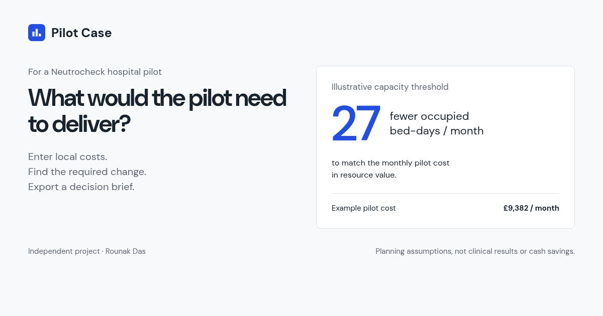

# Pilot Case

**What would a local Neutrocheck pilot need to deliver?**

### [Open the working tool →](https://rounakdas07.github.io/pilot-case/)



Enter local activity, kit and delivery costs. Pilot Case calculates the reduction in **occupied bed-days** needed to match incremental cost in **resource value**, explores a shorter-stay scenario, and exports a decision brief with every assumption and unresolved evidence requirement.

Built by **Rounak Das**, second-year medical student at the University of Nottingham. Independent portfolio prototype; not affiliated with, commissioned by or endorsed by 52North. Developed with AI assistance, with explicit calculation tests and browser checks. Neutrocheck® is a trademark of 52 North Health Ltd.

## Why this exists

52North's 2026 commercial advert describes HCP-use launch preparation, local pilots, pricing and NHS budget-impact work. NIHR announced funding for its community neutropenic-sepsis pathway project in October 2026. The company already has health-economic support: this tool makes **local assumptions and evidence requests** easy to inspect and carry into a discussion. It does not replace a formal health-economic assessment or assert an undisclosed company problem.

## What it does

- Calculates a monthly capacity-value threshold using local inputs.
- Includes extra kits, incremental paid staff time, follow-up, recurring programme costs and one-off setup.
- Separates capacity value from an independently entered avoidable cash cost, defaulting to **zero cash benefit**.
- Flags scenarios requiring more occupancy reduction than the eligible cohort contains.
- Shows a 3×3 sensitivity table for kit price and bed-day resource value.
- Creates a portable HTML/printable brief, full assumptions CSV, aggregate measurement checklist and shareable scenario link.

The initial data are **entirely illustrative**: not 52North pricing, an NHS tariff, a named trust's activity or observed clinical performance. Editing an input does not validate it. Checkboxes record what a local user marks as documented, not independent verification.

## Model and scope

One HCP-performed index test is planned per acute hospital episode. Extra consumed kits are directly entered per 100 episodes. Eligible admissions are a subset of those tested episodes. The model explores a hypothetical reduction in occupied stay, not prevented hospital attendance or diagnostic performance.

```
kits/month = tested episodes × (1 + extra kits per 100 episodes / 100)
paid delivery cost = kits × additional paid minutes / 60 × loaded hourly cost
monthly incremental cost = kits × kit price + paid delivery cost
                         + episodes × extra follow-up cost
                         + recurring costs + setup / pilot months
required bed-days/month = monthly incremental cost / resource value per bed-day
scenario bed-days/month = eligible admissions × assumed shorter stay
resource balance = scenario bed-days × resource value − monthly cost
cash still required = monthly cost − scenario bed-days × avoidable cash per bed-day
```

The cash value is a component of the resource value, not additive. The model assumes entered staffing costs are genuinely incremental paid time. If staff are redeployed without additional spend, set additional paid time to zero and assess workload separately. Do not add a full admission cost or ED tariff to the same occupied bed-day valuation.

The headline rounds required bed-days up to a whole number. All other calculations use full precision. The sensitivity matrix varies price and resource value by ±25%, capped at input bounds. It is not a confidence interval. Monthly activity is constant over the pilot; setup is allocated across its duration. No discounting, causal inference, downstream health outcomes or full cost-effectiveness analysis.

**Clinical boundary:** no patient assessment, triage, diagnosis or treatment advice. Faster results do not automatically free inpatient bed-days. Product accuracy, safety and pathway effects need independent evaluation. A favourable scenario is not clearance, a procurement recommendation or proof of savings. At the source review date (18 November 2026), 52North described its products as in development and not authorised for sale.

## Provenance

Primary sources reviewed 18 November 2026:

1. [52North commercial advert](https://www.linkedin.com/jobs/view/4443509020) — historical HCP-use launch/adoption responsibilities; the indexed advert states first posted 21 July 2026 and now closed. The live URL may redirect. Not an assertion of an open role or confirmed launch date.
2. [NIHR, 9 October 2026](https://www.nihr.ac.uk/news/nihr-awards-funding-embed-innovative-preventive-tech-community-care) — funds a community pathway project led by Dr Mireia Crispin at 52 North Health Ltd. This is prospective research, not demonstrated effect.
3. [52North Neutrocheck product page](https://52north.health/products/neutrocheck) — product purpose and development status.
4. [HRA NeutroD](https://www.hra.nhs.uk/planning-and-improving-research/application-summaries/research-summaries/neutrod/) — diagnostic-performance study, not results or an occupancy outcome study.
5. [NHS Clinical Entrepreneur Programme case studies, February 2023, page 17](https://nhscep.com/wp-content/uploads/2023/05/CEP-Evaluation-Case-studies.pdf) — existing independent health-economic work. No national benefit projection is used here.
6. [NHS England benefits-realisation guidance, 2022/23, paragraphs 116–119](https://www.england.nhs.uk/wp-content/uploads/2021/12/22-23NT-Dt-Guidance-on-aligned-payment-and-incentive-approach-v2.pdf) — cash and capacity distinction; historical principles, not current prices or eligibility rules.

Source evidence establishes the context only. **No default effect or price was derived from it.**

## Run and verify

Static HTML/CSS/JavaScript with no runtime dependencies, API key or build step. Serve this directory with any static web server. GitHub Pages deploys the root of `main`.

```bash
node --test tests/model.test.mjs
```

Tests cover a hand-worked example; kit repeats; setup allocation; zero activity/value; impossible thresholds; cash/resource separation; malformed inputs; sensitivity limits; scenario-link integrity; and CSV formula injection handling. Manual browser checks cover input recalculation, validation recovery, export, sharing and responsive layouts.

## Privacy and reproducibility

Calculations run in-browser; no analytics or application backend. Nothing is submitted to 52North. GitHub Pages receives ordinary page requests. A copied scenario URL explicitly includes all entered inputs, service name, checklist marks and notes in its fragment; anyone you share it with can read them. Do not enter confidential information. The app does not persist form inputs locally; retain a scenario link or export if needed.

Files: `model.mjs` holds the pure calculation and validation functions; `app.mjs` handles the interface and export; `pilot-measures.csv` is an aggregate evaluation planning checklist. DM Sans is bundled under its included Open Font License. Code is MIT licensed.
